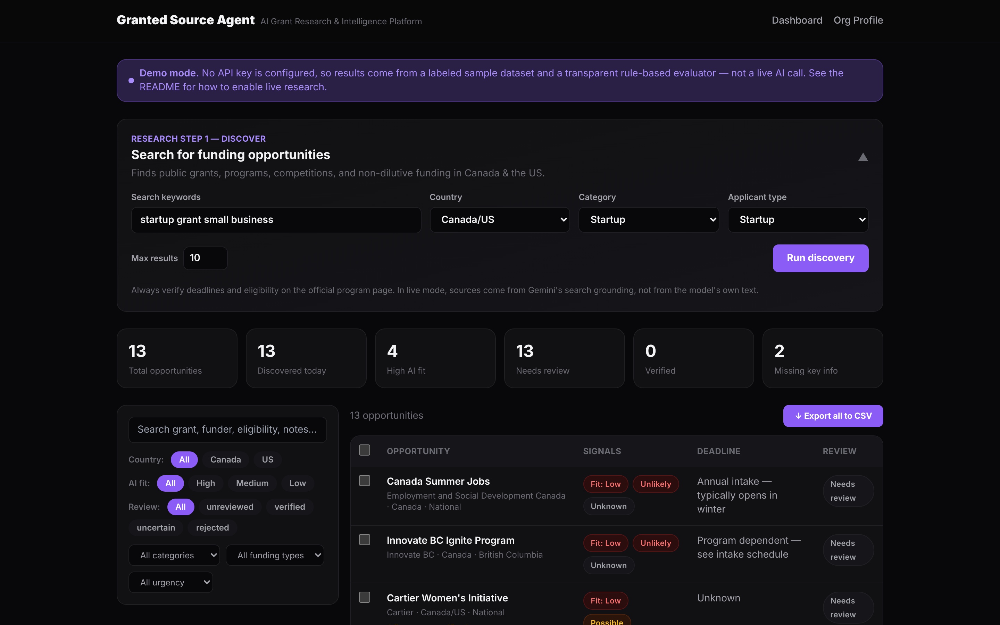
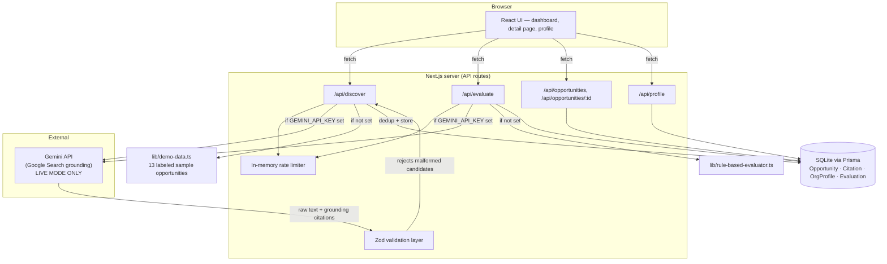
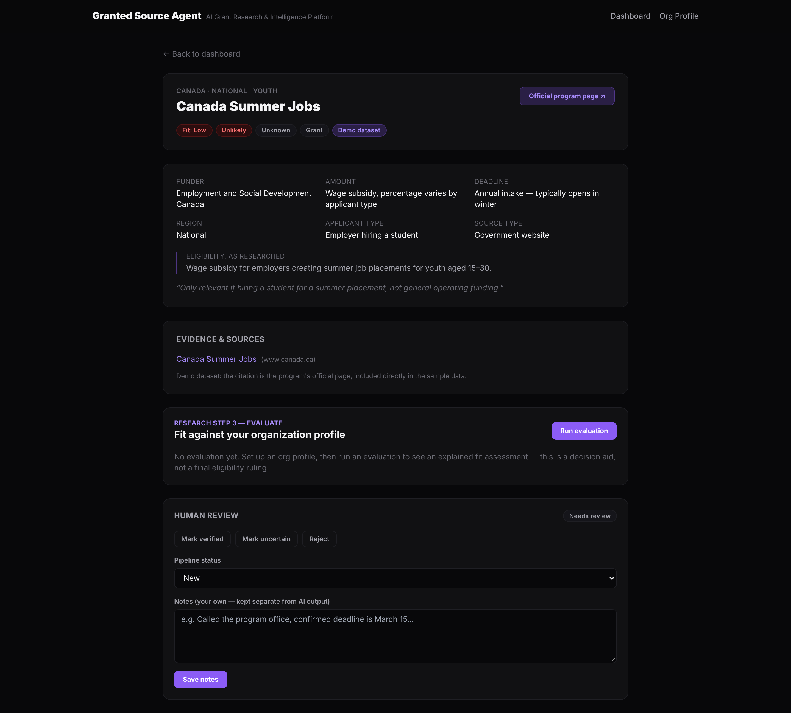
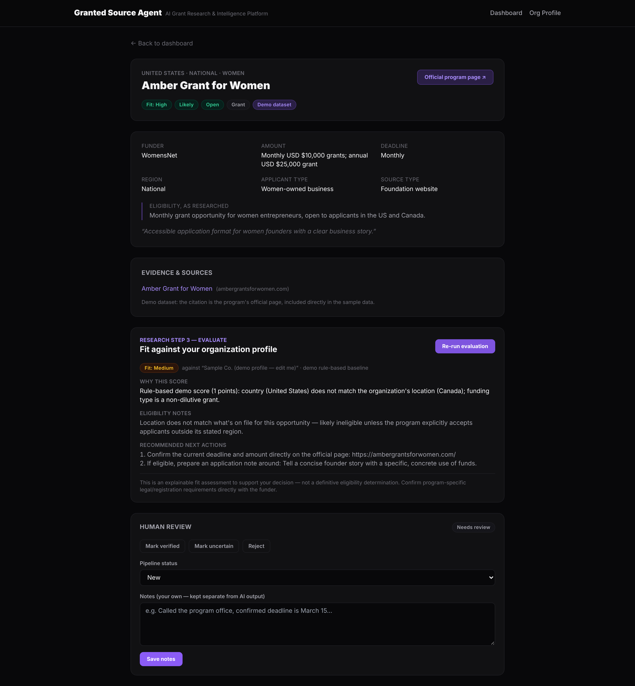
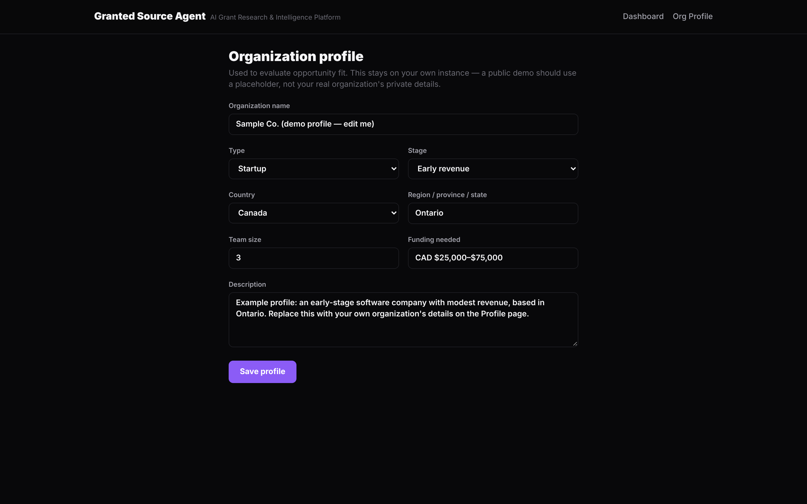
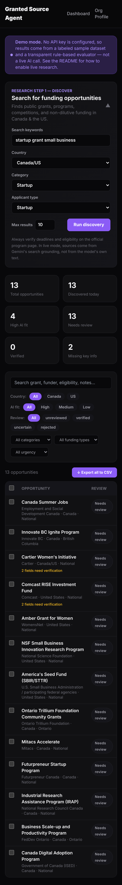

# Granted Source Agent — AI Grant Research & Intelligence Platform

A personal engineering project: an applied-AI system for discovering, verifying, and evaluating non-dilutive
funding opportunities for Canadian and US organizations.

This started as a small weekend tool I built during [Inscend](https://inscend.io) (a software venture I ran
November 2025–November 2026) to speed up grant research. This repository is a from-scratch rebuild of that
tool as a standalone portfolio project, built independently of Inscend. **It is not an active product, not
affiliated with or endorsed by GRANTED, and not a service either company offers.** It's a demonstration of how
I design and build an applied-AI system end to end: a real workflow, explicit handling of uncertainty, an
evaluation framework for the AI's output, and a human-in-the-loop review step — not just a chat wrapper around
an LLM.



## What this actually does

**Discover → Verify → Evaluate → Prioritize → Review → Export**

1. **Discover** — search Canadian/US public funding sources by keyword, geography, category, and applicant
   type.
2. **Verify** — every discovered fact is either confirmed, or explicitly flagged as needing human
   verification. Nothing is silently guessed.
3. **Evaluate** — score a specific opportunity's fit against your organization's actual profile, with
   reasoning you can read, not just a number.
4. **Prioritize** — filter and sort by AI fit, urgency, review status, category.
5. **Review** — mark each opportunity verified / uncertain / rejected, with your own notes, kept separate
   from what the AI said.
6. **Export** — CSV export of your current filtered view or selection.

Two modes, always clearly labeled in the UI:

- **Demo mode** (default, no setup): runs against a 13-entry labeled dataset of real, publicly known Canadian
  and US funding programs, with a transparent rule-based fit evaluator. No API key, no cost, fully
  explorable.
- **Live mode** (opt-in, server-side key required): discovery and evaluation call the Gemini API with
  Google Search grounding, server-side only.

## What changed from the original app

The original was a ~700-line single-page Vite/React app: a client calling the Gemini API directly from the
browser, the user's own API key pasted into `localStorage`, results kept in `localStorage`, no backend, no
tests, no review workflow. Section-by-section detail is in [`docs/AUDIT.md`](docs/AUDIT.md); the short
version:

| | Original | This version |
|---|---|---|
| API key | Pasted by the user, stored in browser `localStorage`, sent from the client | Server-side only (`GEMINI_API_KEY` env var); never requested from or sent to the browser |
| Backend | None — client called Gemini directly | Next.js API routes + Prisma/SQLite |
| Citations | Trusted whatever URL string the model typed | Pulled from Gemini's search-grounding metadata; validated against the pipeline's own schema |
| Missing info | Not distinguished from confirmed facts | Explicit `missingFields` per opportunity, surfaced in the UI |
| Human review | A `status` field existed in the data model but had no UI | Full review panel: verified/uncertain/rejected, notes, pipeline status — kept separate from AI fields |
| Validation | None — whatever JSON came back was trusted | Zod schema at every boundary; malformed model output is rejected and counted, not coerced |
| Tests | None | 56 unit/integration/component tests ([`tests/`](tests)) |
| AI evaluation | None | Labeled fixture dataset + reproducible harness ([`eval/`](eval)) |
| Demo mode | Sample data mixed into the same list as real results, no distinction | Structurally separate, always labeled, zero cost |

Kept from the original: the grant data schema's shape (extended), the CSV export logic, the discovery
prompt's existing discipline ("don't invent, use Unknown over guessing, exact enums"), and the dedup concept.

## Architecture



**Stack:** Next.js 15 (App Router) + TypeScript, Prisma + SQLite, Zod, Tailwind CSS, Vitest + React Testing
Library. One deployable app — API routes are the backend, no separate server to run or deploy.

### Why this stack

- **Next.js App Router over a separate Express backend**: one TypeScript codebase, API routes double as the
  backend without a second deployable, and it still runs on the same kind of host (Vercel) the original
  `vercel.json` assumed.
- **Prisma + SQLite over a hosted database**: zero hosting cost for a project that's primarily meant to be
  cloned and run, with real schema structure and migrations rather than ad hoc JSON files. The trade-off is
  explicit in [Limitations](#limitations-honestly): SQLite doesn't persist reliably on most serverless
  hosts. See [Deployment](#deployment) for what that means in practice.
- **Zod at every boundary**: API input, and — more importantly — the model's own JSON output. A field the
  schema doesn't accept is rejected and counted, not coerced into something that looks confident.

## Data flow: how a fact becomes "confirmed" vs "needs verification"

This is the part of the system actually aimed at the brief's "handles imperfect information" requirement:

1. The discovery prompt instructs the model to use `"Unknown"` / `"Not stated"` rather than invent a
   specific-looking value ([`lib/prompts.ts`](lib/prompts.ts)).
2. Every candidate is validated against [`DiscoveredOpportunitySchema`](lib/validation.ts) — wrong enum
   value, missing required field, or a malformed URL, and the candidate is dropped, not repaired into
   something plausible.
3. [`mapDiscoveredOpportunity`](lib/opportunity-mapper.ts) checks each surviving candidate's amount,
   deadline, eligibility summary, funder name, and region against `isConfirmedValue()` — a placeholder like
   `"Unknown"` doesn't count as confirmed. Anything unconfirmed goes into a `missingFields` array stored
   alongside the record.
4. In **live mode**, the opportunity's citations come from Gemini's **search-grounding metadata**
   ([`lib/gemini.ts`](lib/gemini.ts)) — the actual URLs Google Search returned — not from a URL string the
   model typed into its own JSON. If grounding returned nothing, `missingFields` includes
   `"source_citation"`.
5. The UI (`OpportunityDetailClient`) renders every unconfirmed field with a visible "(unverified)" marker
   and a banner listing what still needs a human to check, before any fit evaluation or decision happens.
6. Evaluating fit (`/api/evaluate`) never overwrites the research data — it writes a separate `Evaluation`
   record, versioned by time, so you can see how the assessment changed as your profile or the opportunity
   changed.
7. Marking something "verified" (`ReviewPanel`) only ever touches `reviewStatus`, `reviewNotes`, and
   `status` — never the AI-asserted fields. A human's confirmation and the AI's claim are different data,
   on purpose.

## AI evaluation framework

See [`eval/README.md`](eval/README.md) for full methodology. Summary: **this project had no Gemini API key
available during development**, so the harness runs labeled, hand-authored fixtures — shaped exactly like
real Gemini discovery output, including deliberately flawed examples — through the actual production
pipeline (extraction → validation → mapping → dedup), not a live model. It measures source citation
accuracy, extraction accuracy, missing-field handling, duplicate detection, eligibility-classification
agreement, and one concrete, checkable proxy for unsupported/hallucinated claims (citation-domain
mismatch). Current result: **11/12 labeled cases pass**, and the one that doesn't is intentional — a case
built specifically to demonstrate the harness catching a disagreement between the model's self-reported fit
score and what the stated eligibility text actually supports. Run it yourself:

```bash
npm run eval
```

## Security & privacy

- **No API key ever reaches the browser.** `GEMINI_API_KEY` is read only in server-side route handlers
  ([`lib/gemini.ts`](lib/gemini.ts)); there is no UI control to enter one, by design — the original app's
  "paste your key here" pattern is exactly what this replaces.
- **Demo mode needs no credentials at all** and makes no external network calls.
- **Rate limiting** on `/api/discover` and `/api/evaluate` caps how many live calls one client can make per
  minute ([`lib/rate-limit.ts`](lib/rate-limit.ts)), so a server-held key can't be run up by uncontrolled
  usage. Documented limitation: it's in-memory and per-process, which is a real control on a single-instance
  deployment but not a global one across a multi-instance serverless fleet — see the comment in that file.
- **All inputs and all model output are validated with Zod** before being trusted or stored.
- **The seeded "sample organization profile" is clearly labeled as a placeholder** (`"Sample Co. (demo
  profile — edit me)"`) — a public demo of this app should never be pointed at a real organization's private
  financial or operational details, since the dashboard and exports aren't access-controlled.
- **No secrets are logged.** [`lib/logger.ts`](lib/logger.ts) logs event metadata (counts, status, error
  messages) — never request bodies or API keys.

## Local development

```bash
npm install
cp .env.example .env         # defaults to SQLite + demo mode, no edits needed to start
npm run setup                # generate Prisma client, create the DB, seed demo data
npm run dev                  # http://localhost:3000
```

To enable live research, add to `.env`:

```bash
GEMINI_API_KEY="your-server-side-key"
```

**Note on live mode:** the live-mode code path (`lib/gemini.ts`, `lib/discovery-service.ts`'s
`runLiveDiscovery`, and the evaluation route's live branch) was implemented against Gemini's documented
request/response shape for Google-Search-grounded generation, but **has not been exercised against the real
API in this project's development** — no key was available. If you enable it, treat the first few runs as a
verification pass. The eval harness and all 56 automated tests run against mocked/fixture responses, not
live calls, specifically so the test suite never costs money or depends on a key.

### Scripts

| Command | What it does |
|---|---|
| `npm run dev` / `build` / `start` | Next.js dev server / production build / production server |
| `npm run lint` / `typecheck` | ESLint / `tsc --noEmit` |
| `npm test` | Vitest — 56 unit, component, and API-route integration tests |
| `npm run eval` | AI pipeline evaluation harness, writes `eval/report.json` |
| `npm run db:seed` | Re-seed the demo dataset and a sample org profile |

## Deployment

This is a standard Next.js app and deploys to Vercel, Railway, Render, Fly.io, or any Node host.

**Be aware of SQLite's limitation on serverless hosts:** platforms like Vercel run API routes as ephemeral
serverless functions with a read-only or non-persistent filesystem between invocations, so a SQLite file
written at runtime won't reliably survive. For a deployment that needs real persistence (not just a
read-only demo), point `DATABASE_URL` at a hosted Postgres instance instead (e.g. a free-tier
[Neon](https://neon.tech) database) and run `npx prisma db push` against it once before deploying — the
schema is provider-agnostic Prisma, so this is a connection-string change, not a rewrite. This project ships
with SQLite because it's genuinely sufficient for local use and keeps the project's infrastructure cost at
zero; swapping it was a decision deliberately left to whoever deploys it, rather than assumed.

## Technical trade-offs

- **Citations are attributed per discovery call, not per candidate.** Gemini's search grounding returns
  sources for the whole response, not individually tagged per JSON object in a batch. When a discovery call
  returns 5 opportunities, all 5 currently share that call's citation list. A more precise (but more
  expensive) approach would issue one grounded call per candidate; documented as future work rather than
  silently assumed to be fine.
- **Rule-based demo evaluator vs. live LLM evaluator** are intentionally different in sophistication — the
  demo one is simple and fully transparent (see [`lib/rule-based-evaluator.ts`](lib/rule-based-evaluator.ts))
  specifically so a reader can verify every point of its score by hand. It is not a claim that it's as good
  as an LLM evaluation; it's a zero-cost baseline, and the eval framework is structured so a live evaluator
  could be compared against it once one has actually been run.
- **In-memory rate limiting** instead of Redis/Upstash: correct for a single-instance deployment, a known
  gap on multi-instance serverless — see [Security & privacy](#security--privacy).

## Limitations (honestly)

- Live mode (Gemini calls) has not been run against the real API during this project's development — see
  [Local development](#local-development).
- Hallucination detection is limited to one concrete, checkable signal (citation-domain mismatch) — it
  cannot fact-check a claim's content. See [`eval/README.md`](eval/README.md).
- SQLite is not a durable choice for most serverless deployments without the Postgres swap described above.
- Rate limiting is per-process, not global, on a multi-instance deployment.
- The organization profile is single-row (one org per instance) — intentional for this project's scope, not
  multi-tenant.

## Future improvements

- Per-candidate grounded verification calls for more precise citation attribution.
- A live-mode fixture set captured from real Gemini runs, added to the eval harness alongside the current
  hand-authored cases (see `eval/README.md`).
- Multi-tenant org profiles if this were ever used by more than one organization at a time.
- A Redis-backed rate limiter for genuine multi-instance deployments.

## Portfolio case study

**Problem.** Manually researching grant and non-dilutive funding opportunities is slow, and the information
is inherently incomplete and changes over time — a tool that treats every AI-extracted "fact" as equally
certain will mislead the person relying on it.

**What I built.** A system that treats uncertainty as a first-class concept: every researched fact is either
confirmed or explicitly flagged, every fit score comes with a plain-language reason, every source is backed
by a real citation rather than a model's self-reported URL, and the AI's assessment is stored separately from
a human's decision so neither silently overwrites the other.

**My contribution.** Solo project: product shape, data model, the discovery/evaluation prompts and their
validation boundary, the Next.js application (frontend and API layer), the Prisma schema, the rule-based
demo evaluator, the automated test suite, and the evaluation harness and its labeled dataset.

**Outcome.** A working, fully-tested (56 passing tests), demo-explorable application with zero required
cost, a documented and reproducible AI-evaluation process, and an honest account — in this README — of
exactly what has and hasn't been verified end to end.

## Screenshots

| Dashboard (demo mode) | Opportunity detail |
|---|---|
|  |  |

| Explainable evaluation | Org profile |
|---|---|
|  |  |

| Mobile |
|---|
|  |
